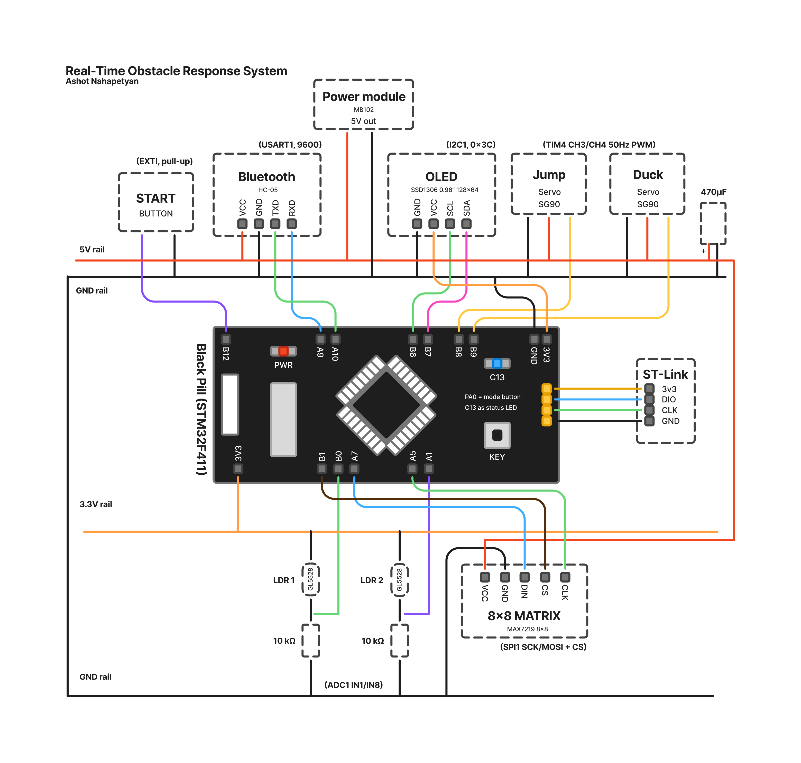
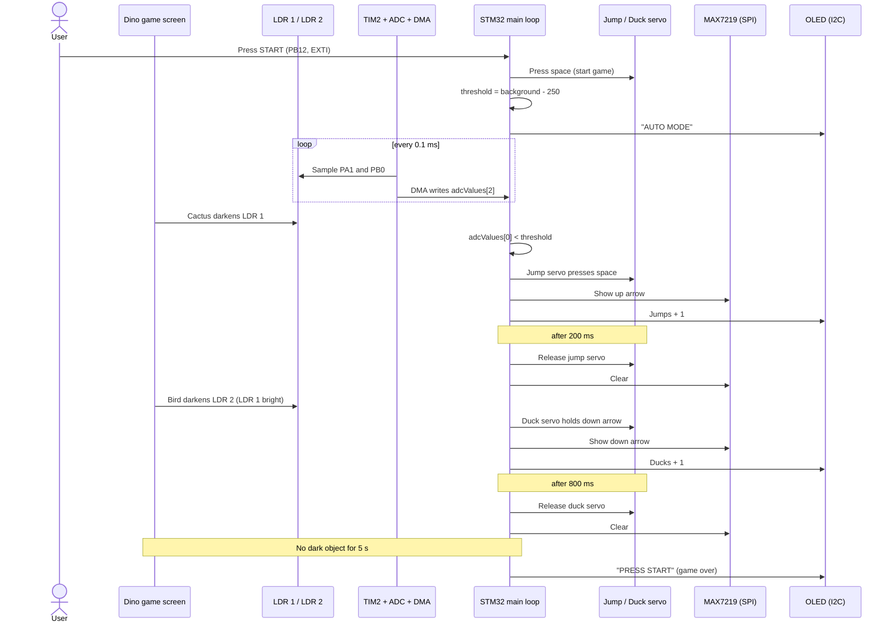
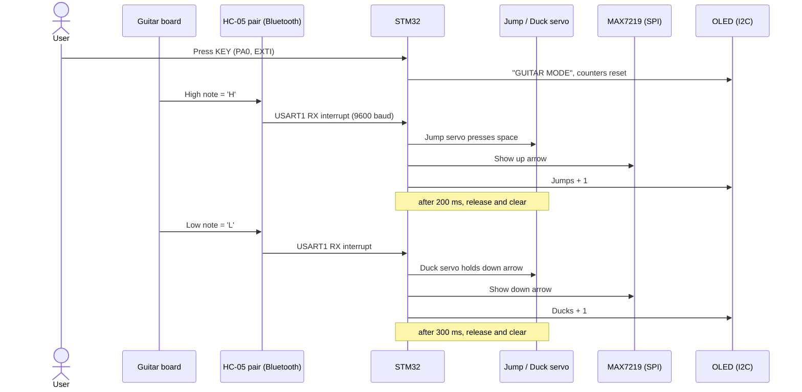

# STM32 Google Dino Automation

  

## Project Objective
To develop an autonomous system using the STM32F411CEU6 that detects obstacles in the Google Chrome Dino game and performs timely jumps and ducks using sensor feedback and servo motor control.

## Components and Their Purpose

- **STM32F411CEU6 Black Pill:** Main microcontroller responsible for sensor processing, timing, decision-making, and peripheral control.
- **GL5528 Photoresistors (2):** Detect approaching cacti (ground level) and flying birds (head level) by sensing changes in screen brightness.
- **10 kΩ Resistors (2):** Form voltage dividers with the photoresistors to provide measurable analog voltages to the STM32 ADC.
- **SG90 Servo Motors (2):** Physically press the keyboard's spacebar for jumping and down arrow for ducking.
- **Breadboard Power Module:** Powers the servos, the Bluetooth module and the LED matrix separately from the microcontroller.
- **470 µF Capacitor:** Stabilizes the servo power supply during current surges.
- **SSD1306 OLED Display (0.96"):** Displays operating mode and game statistics.
- **HC-05 Bluetooth Modules (2):** Wireless UART link between the STM32 and the guitar board.
- **MAX7219 8x8 LED Matrix:** Indicates the current action (jump or duck).
- **Push Button:** Starts and stops a round.

## Features

- Automatic obstacle detection and classification (cacti and birds).
- Jumping over cacti and ducking under birds.
- Continuous sensor acquisition with ADC and DMA.
- Automatic sensor calibration at the start of every round.
- Game over detection.
- Wireless UART communication with an external guitar-detection board over Bluetooth.
- Watchdog reset in case of a software freeze.
- Action indicator on the LED matrix (up arrow for jump, down arrow for duck).

## Communication and Peripherals

| Peripheral | Pins | Use |
|---|---|---|
| ADC1 + DMA | PA1, PB0 | Photoresistor readings |
| TIM2 | - | ADC trigger, 10 kHz |
| TIM4 PWM | PB8, PB9 | Jump and duck servos |
| I2C1 | PB6, PB7 | OLED display |
| USART1 | PA9, PA10 | Bluetooth link with the guitar board, 9600 baud |
| SPI1 | PA5 (SCK), PA7 (MOSI), PB1 (CS) | MAX7219 LED matrix |
| GPIO / EXTI | PA0, PB12, PC13 | Mode button, START button, status LED |
| IWDG | - | Watchdog |

## Wiring Diagram
<p align="center>
    
</p>

Full quality version: [wiring_diagram.pdf](docs/wiring_diagram.pdf)

> [!WARNING]
> Power module GND must be connected to board GND. Breadboard power rails are split in the middle.


## Development

- STM32CubeIDE
- STM32 HAL Library
- C programming language

## Progress

| Part | Function | Peripherals | Status |
|---|---|---|---|
| 1 | Status LED and mode button | GPIO, EXTI | Done |
| 2 | Jump and duck servos | TIM4 PWM | Done |
| 3 | OLED screen with mode and counters | I2C1 | Done |
| 4 | Bluetooth link with guitar board | USART1 | Done (tested with Arduino Mega) |
| 5 | Watchdog | IWDG | Done |
| 6 | Photoresistor reading | ADC, DMA, TIM2 | Done |
| 7 | Cactus detection and jumping | - | Done |
| 8 | START button and auto calibration | GPIO, EXTI | Done |
| 9 | Bird detection and ducking | - | Done |
| 10 | Game over detection | - | Done |
| 11 | LED matrix action indicator | SPI1 | Done |

**Remaining:**

- [ ] Test with the partner's guitar board
- [ ] Final tuning of servo and LDR positions
- [ ] Add demo video

## Sequence Diagram

### Auto mode


### Guitar mode


## Game Speed

The game speed increases over time. A timing model based on the game source code was not accurate, because the game rounds the movement every frame and depends on the monitor refresh rate. For the demonstration, the speed is fixed from the browser console (speed 9, at which birds also appear):

```js
r = Runner.getInstance(); r.config.acceleration = 0; r.config.speed = 9; r.currentSpeed = 9
```
> [!TIP]
> Ru the script again after every page reload.


## System Description

<details>
    <summary><b>1. Status LED and mode button</b></summary>

    The onboard LED (PC13) blinks slowly in Auto mode and fast in Guitar mode. The KEY button (PA0) toggles the mode through an external interrupt. Presses closer than 200 ms are ignored as button bounce.
</details>


**2. Servos.** TIM4 generates PWM for two servos: PB8 (jump) and PB9 (duck). Prescaler 99 and period 19999 give 50 Hz, so the CCR value equals the pulse width in µs. Each servo moves to the press position and returns after a set time (200 ms for jump, 800 ms for duck in Auto mode). The servos are powered from a separate breadboard power module.

**3. OLED display.** A 0.96" SSD1306 display on I2C1 (PB6, PB7) shows the mode (or PRESS START) and the number of jumps and ducks. The screen is redrawn only when a value changes, since a full update takes several milliseconds. Counters reset on mode change and at the start of each round. The stm32-ssd1306 library is used.

**4. Bluetooth link.** USART1 (PA9, PA10) is connected to an HC-05 module at 9600 baud. The guitar board sends one character: 'H' (high note) for jump and 'L' (low note) for duck. Commands are accepted only in Guitar mode. Reception is interrupt-based and restarts automatically after a line error. The link was tested with a second HC-05 on an Arduino Mega. The modules are configured as master and slave with AT commands and connect automatically.

**5. Watchdog.** The IWDG has a timeout of about 1 second and is refreshed in every main loop cycle. If the program freezes, the board resets. The watchdog is paused during debugging.

**6. Photoresistor reading.** Two photoresistors with 10 kΩ resistors form voltage dividers on PA1 (LDR 1, ground level) and PB0 (LDR 2, head level). TIM2 triggers the ADC 10,000 times per second, and DMA stores the results in an array without CPU involvement.

**7. Cactus detection.** LDR 1 is placed in front of the dino. An approaching cactus darkens the screen area, the reading drops below the threshold, and the jump servo presses space. The reading must rise clearly above the threshold (hysteresis of 100) before the next jump, so each cactus causes only one jump.

**8. START button and calibration.** The START button (PB12) presses space to start the game, measures the brightness of the empty screen, and sets each threshold 250 below it. This keeps detection reliable under different room light and monitor brightness. A second press stops the round. A single fixed threshold for both sensors was also tested, but it missed fast obstacles, so automatic calibration is used.

**9. Bird detection.** LDR 2 is placed slightly above the dino's head. If LDR 2 detects an object while LDR 1 does not, the object is a bird, and the duck servo holds the down arrow until it passes. If both sensors are dark, the object is a tall cactus and the dino jumps.

**10. Game over detection.** If neither sensor detects an object for 5 seconds, the game is considered over (the picture stops moving after a crash), and the screen returns to PRESS START.

**11. LED matrix.** A MAX7219 8x8 LED matrix is connected to SPI1 (PA5 clock, PA7 data, PB1 chip select). Only transmission is needed. The driver is in separate files `max7219.c` and `max7219.h`. The matrix shows an up arrow while jumping and a down arrow while ducking, and is cleared when the servo returns. It is powered from the 5V output of the power module. A microSD card logger was planned for SPI originally, but it was not reliable on the breadboard, so it was replaced with the LED matrix.

## Power

The board is powered from the ST-Link 3.3V (or USB-C). The servos, the Bluetooth module and the LED matrix are powered from the breadboard power module, whose ground is connected to the board ground. On long breadboards the power rails are split in the middle and must be bridged with wires.

**Course:** ENGS 251 – Embedded Systems Project
